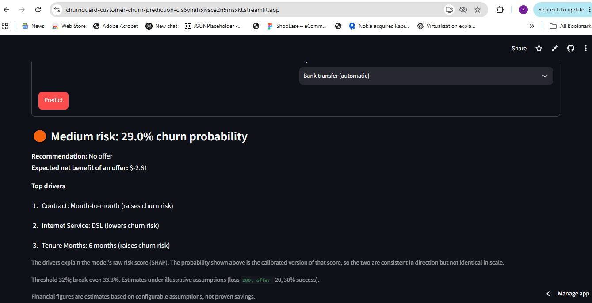
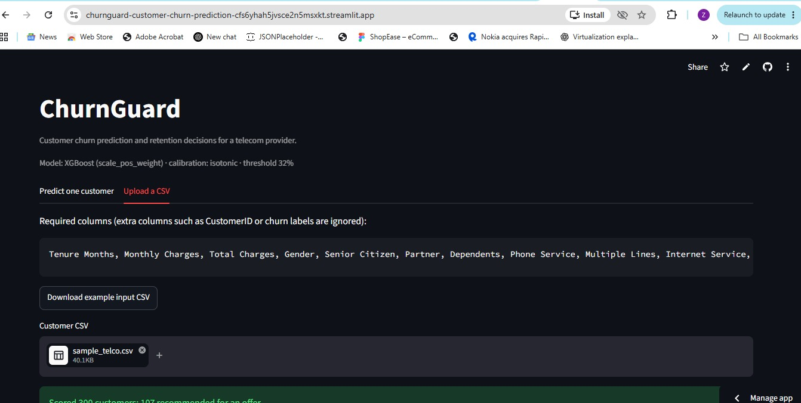
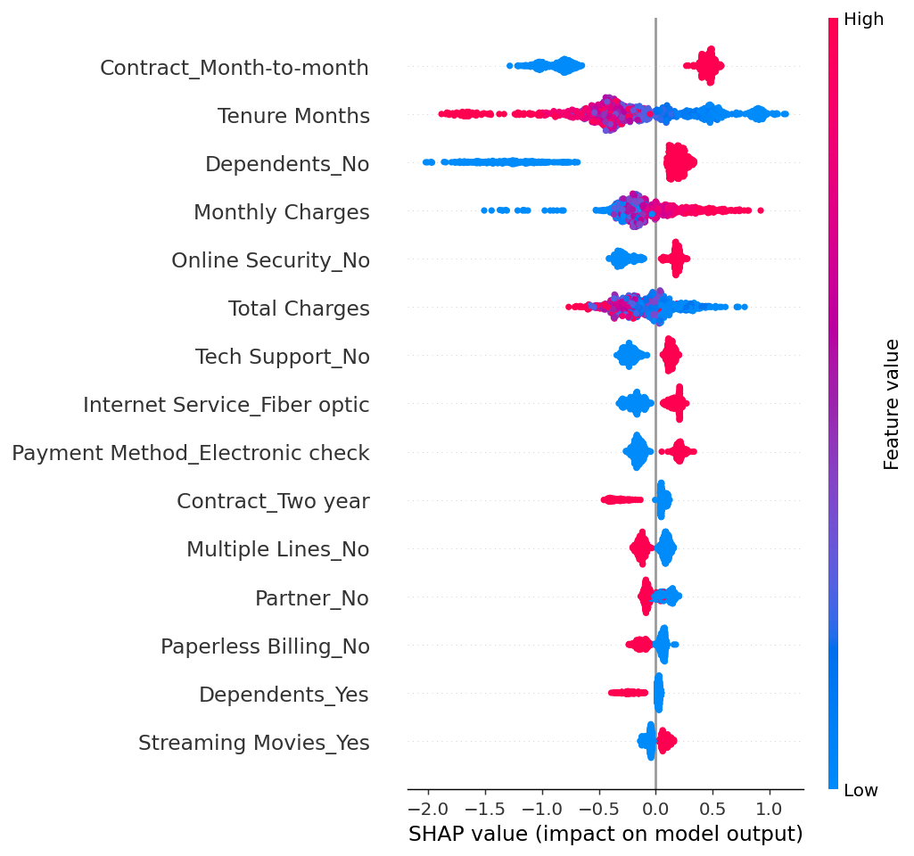
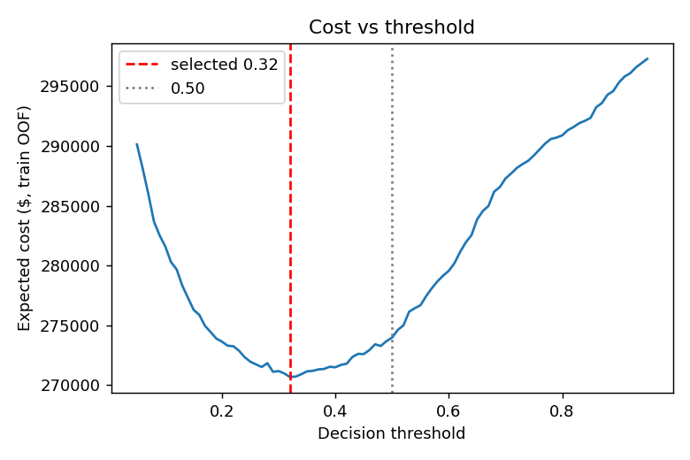

# ChurnGuard: Customer Churn Prediction & Retention

ChurnGuard predicts which telecom customers are likely to leave, explains why, and recommends whether a retention offer is worth making under a configurable cost model. It ships with a Streamlit app for single-customer and batch CSV scoring.

## Key results (held-out test set, 1,409 customers, scored once)
| PR-AUC | ROC-AUC | Recall @ threshold 0.32 | Precision @ 0.32 | Expected saving vs no offers |
|---|---|---|---|---|
| 0.6724 | 0.8538 | 0.749 | 0.546 | $6,540 (assumed costs) |

Savings are estimates under illustrative cost assumptions (see "Threshold and cost matrix").

## Links
| | |
|---|---|
| Live app (Streamlit Cloud) | https://churnguard-customer-churn-prediction-cfs6yhah5jvsce2n5msxkt.streamlit.app/|
| Demo video (2–3 min) | https://www.loom.com/share/e02ab61b52a04553903ef844bb82fc77 |


## Screenshots
| Single prediction | CSV upload |
|---|---|
|  |  |

## Business problem
Losing a customer costs far more than a targeted retention offer, but contacting everyone wastes money. The goal is to rank customers by churn risk, pick a decision threshold from costs instead of the default 0.50, and show the top drivers behind each prediction.

## Dataset
`Telco_customer_churn.xlsx`, sheet `Telco_Churn`: 7,043 customers, 33 columns, no duplicate rows, 26.5% churn (`Churn Value` = 1). `Total Charges` is stored as text; 11 blank values (all tenure 0) are converted to NaN and median-imputed inside the pipeline.

The Excel file is not committed (place it at `data/Telco_customer_churn.xlsx`). A 300-row stratified sample with the model columns and the target is committed as `data/sample_telco.csv`, so the modelling notebook runs without the Excel file (full-data cells are skipped and say so).

## Preprocessing and leakage prevention
- 19 model inputs: 3 numeric (`Tenure Months`, `Monthly Charges`, `Total Charges`) and 16 categorical.
- Excluded: `CustomerID`, `Churn Label`, `Churn Value`, `Churn Score`, `Churn Reason`, `CLTV`, `Count`, `Country`, `State`, `City`, `Zip Code`, `Lat Long`, `Latitude`, `Longitude`. `CLTV` is excluded because it cannot be shown to be free of outcome information; it is used only in a labelled reporting calculation.
- One `ColumnTransformer` (median impute + scale for numerics; most-frequent impute + one-hot with `handle_unknown="ignore"` for categoricals) lives inside every pipeline, so cross-validation never sees preprocessing fit on validation folds, and unseen categories are handled at inference.

## EDA findings
From `notebooks/churn_analysis.ipynb` (computed on the full dataset):
- Churn by contract: month-to-month 42.7%, one year 11.3%, two year 2.8%.
- Churn by tenure: 0-12 months 47.4%, 13-24 28.7%, 25-48 20.4%, 49-72 9.5%.
- Fiber optic 41.9% vs DSL 19.0%; internet customers without tech support 41.6% vs 15.2% with it.
- Electronic check 45.3% vs 15.2-19.1% for other payment methods.
- Churners have higher median monthly charges ($79.65 vs $64.43) but lower median total charges ($703.55 vs $1,683.60).

These are associations, not proven causes.

## Models and methodology
Stratified 80/20 train/test split (seed 42). All model selection, calibration and threshold tuning use only the training split; the test set is evaluated once at the end. Candidates were compared with 5-fold stratified cross-validation using out-of-fold predictions: Dummy baseline, Logistic Regression (class weights), Logistic Regression + SMOTE, Random Forest (class weights), XGBoost (`scale_pos_weight`), and XGBoost + SMOTE.

The full walk-through (comparison, imbalance, calibration, threshold, test evaluation, SHAP, per-customer value) is in `notebooks/churn_modelling.ipynb`; it imports the same `src/` functions as `train.py`.

**Imbalance handling.** SMOTE runs inside an `imblearn` Pipeline after one-hot encoding, so only the training portion of each fold is oversampled; validation folds and the test set are never resampled. SMOTE is applied to one-hot columns (not SMOTENC), so synthetic rows can have fractional category indicators; this is an approximation, and class weighting performed as well or better.

**Why PR-AUC.** With 26.5% positives, accuracy and ROC-AUC can look good while precision on the churn class is poor. PR-AUC (average precision) measures ranking quality on the minority class, which is what drives who gets an offer. The dummy baseline scores about 0.265 (the churn rate).

## Results (5-fold out-of-fold, training split; precision/recall/F1 at 0.50)
| Model | PR-AUC | ROC-AUC | Precision | Recall | F1 |
|---|---|---|---|---|---|
| XGBoost (scale_pos_weight) | 0.6859 | 0.8626 | 0.5369 | 0.8167 | 0.6479 |
| XGBoost (SMOTE) | 0.6827 | 0.8625 | 0.6042 | 0.7003 | 0.6487 |
| Random Forest (class weights) | 0.6793 | 0.8622 | 0.5584 | 0.7773 | 0.6499 |
| Logistic Regression (class weights) | 0.6760 | 0.8585 | 0.5295 | 0.8094 | 0.6402 |
| Logistic Regression (SMOTE) | 0.6754 | 0.8578 | 0.5417 | 0.7993 | 0.6458 |
| Dummy (prior) | 0.2653 | 0.4999 | 0.0000 | 0.0000 | 0.0000 |

Differences between the top four models are small (under 0.015 PR-AUC), so the choice of XGBoost is a narrow win, not a decisive one. Confusion matrices for each model are in `reports/model_comparison.csv`.

**Held-out test set (1,409 customers), selected model:** PR-AUC 0.6724, ROC-AUC 0.8538. At the selected threshold (0.32): precision 0.546, recall 0.749, F1 0.631, confusion matrix TN 802 / FP 233 / FN 94 / TP 280. At 0.50: precision 0.682, recall 0.527, F1 0.594.

## Calibration
Class-weighted XGBoost scores are not probabilities. Out-of-fold Brier score: 0.1534 uncalibrated, 0.1298 sigmoid, 0.1291 isotonic; log loss: 0.4561, 0.4008, 0.4190. Isotonic `CalibratedClassifierCV` (5-fold, fit on the training split only) was selected by lowest Brier score, so the app's percentages are calibrated probabilities. Sigmoid is slightly better on log loss and the Brier gap is only 0.0007, so either would be defensible; isotonic gives step-shaped probabilities, including values very close to 0% or 100%. Plot: `reports/calibration.png`.

## Threshold and cost matrix
Illustrative assumptions (not real company figures; configurable in `src/business.py`): cost of losing a customer $200, offer cost $20, offer success rate 30%.
- Expected net benefit of an offer = churn probability x 0.30 x $200 - $20, which is positive above a break-even probability of 33.3%.
- Expected policy cost = offer costs + (churners x $200, reduced by the 30% success rate when contacted).
- The threshold was chosen on a 0.01 grid by minimising cost on out-of-fold training predictions: **0.32**, then frozen before the test set was scored.

Test-set comparison (estimates under these assumptions):
| Policy | Contacted | Expected cost | Saving vs no offers |
|---|---|---|---|
| Model @ 0.32 | 513 | $68,260 | $6,540 |
| Model @ 0.50 | 289 | $68,760 | $6,040 |
| Contact everyone | 1,409 | $80,540 | -$5,740 |
| No offers | 0 | $74,800 | $0 |

The gain over 0.50 is small (about $500 on this test set), and the whole saving depends on the assumed 30% success rate. A reporting-only CLTV view (84 expected retained churners x mean CLTV of churners $4,085 = $343,169 estimated lifetime value retained, before offer costs of $10,260) is printed in `reports/evaluation_summary.md`; it is an estimate, not realised revenue.

## Per-customer value estimate
To prioritise offers, the app also shows, for every scored customer, the **value at stake** (monthly charges x 12 months, `VALUE_HORIZON_MONTHS` in `src/business.py`) and the **expected offer value** = churn probability x 0.30 x value at stake - $20. Customers recommended for an offer get an **Offer Priority** rank (1 = highest expected value), so equally risky customers are ordered by revenue at risk. This is a ranking aid on top of the model: the offer decision itself still follows the cost-based threshold, which uses one flat loss cost.

## Explainability (SHAP)
`src/explainability.py` uses `shap.TreeExplainer` on the fitted XGBoost model. SHAP values explain the uncalibrated model score, while the displayed probability is the calibrated one (the app says this next to the reasons). One-hot SHAP values are summed back to the original feature so reasons read like "Contract: Month-to-month (raises churn risk)". Global importance (mean |SHAP|, `reports/shap_importance.csv`): Contract, Dependents, Tenure Months, Monthly Charges, Online Security. Summary plot: `reports/shap_summary.png`.




## Risk categories
High: probability at or above the threshold. Medium: below the threshold but at least 15% (the floor is capped at the threshold so categories stay consistent). Low: below 15%.

## Application
- **Predict one customer:** form with dropdowns and numeric controls; shows probability, risk, recommendation, top three reasons, expected net benefit, and value at stake.
- **Upload a CSV:** validates required columns, ignores target/leakage and extra columns, scores every row through the same pipeline, shows the table (with offer priority) and offers a results download plus an example input CSV.
- Loads saved artifacts from `models/`; shows a clear message if they are missing or incompatible.

## Run locally
```bash
pip install -r requirements.txt
streamlit run streamlit_app.py     # http://localhost:8501 

# optional:
python train.py                    # rewrites models/ and reports/
```
Artifacts in `models/` total under 400 KB, so the app needs no retraining or external downloads.

> **If you retrain, update this README.** Boosted-tree results can differ slightly between machines and library builds (the threshold moved between 0.32 and 0.35 across two runs here). All numbers in this README were produced with the library versions pinned in `requirements.txt` and seed 42. After any retrain, copy the numbers from `reports/evaluation_summary.md` into this file.

## Deployment
**Streamlit Community Cloud (live demo).** The app is a Streamlit app, so it is deployed on Streamlit Cloud: it builds straight from this GitHub repo and `requirements.txt` with no extra configuration, redeploys on every push, and has a free tier suitable for a demo. Entry point: `streamlit_app.py`; Python 3.12.

**Why not Hugging Face Spaces.** I tried to deploy there and could not complete it, for these reasons:
1. *First attempt (configuration error on my side).* The Space metadata said `sdk: gradio`, but the code was a Streamlit app (`app.py` was a copy of `streamlit_app.py`), so it could not run as a Gradio Space.
2. *Second attempt (Docker SDK).* Hugging Face no longer has a built-in Streamlit SDK, so a Streamlit app has to run as a Docker Space (`sdk: docker`, `app_port: 8501`). When I created a Docker Space on a free account, the sign-up page showed that Docker Spaces need a paid plan, so I could not deploy it for free.
3. *Pushing the repo to the Space.* The push was rejected by the Hugging Face server with this message:
   ```
   remote: Your push was rejected because it contains binary files.
   remote: Please use https://huggingface.co/docs/hub/xet to store binary files.
   remote: Offending files:
   remote:   - models/model.joblib (ref: refs/heads/main)
   remote:   - reports/shap_summary.png (ref: refs/heads/main)
   ```
   Binary files must be uploaded through Hugging Face's own tooling instead of plain `git push`.

Because the live demo already works on Streamlit Cloud for free, I did not pursue Hugging Face further, and the repo contains no Docker or Hugging Face setup.

**Why Streamlit instead of Gradio.** The task stack mentions Gradio. Streamlit was chosen because it makes the single-customer form, the batch table with download and the explanation text easy to lay out on one page, and it deploys to Streamlit Cloud directly from GitHub with no extra files.

## Limitations
- Offer success rate, offer cost, loss cost and the 12-month value horizon are assumptions; savings are estimates, not proven revenue.
- Single dataset, single snapshot: no time-based validation, so performance on future customers may differ.
- The test set is one split of 1,409 customers; metrics carry sampling uncertainty.
- Churn reasons in SHAP are model associations, not causal effects.
- SMOTE here operates on one-hot features (approximation).
- Isotonic calibration was chosen by Brier score; it is slightly worse than sigmoid on log loss and can output probabilities near 0% or 100%.

## Technologies
Python, pandas, NumPy, scikit-learn, imbalanced-learn, XGBoost, SHAP, Streamlit, Matplotlib, Seaborn, Joblib, Openpyxl, Jupyter.
